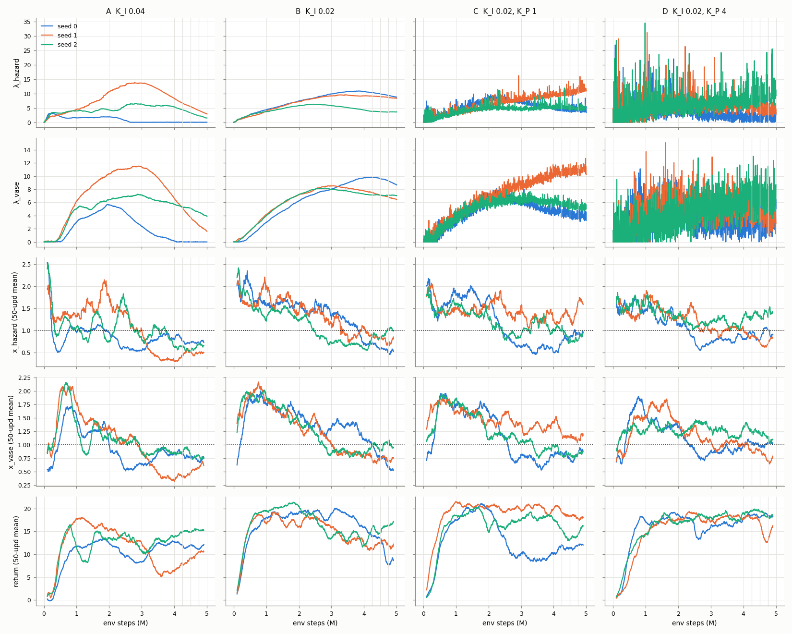
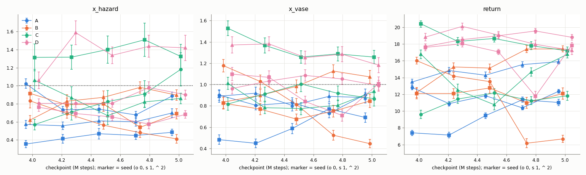

# E11 spg-v2-pi: projected PI multipliers for multi (SafetyPointGoal2)

**Status (2026-10-28):**
- Training finished for all 12 runs (2026-10-24 22:54 → 2026-10-26 ≈ 03:00 KST).
- Validation finished: 60/60 checkpoint evaluations, done 2026-10-26 06:55.
- **Selection on validation: D (K_I 0.02, K_P 4)**, see [Selection](#selection).
- Held-out (500 episodes): **not run yet**. It is launched only after this selection is committed.

Config: [`configs/safety/spg-v2-pi.json`](../../configs/safety/spg-v2-pi.json). Raw outputs:
`runs/spg-v2-pi-*/multi-s{0,1,2}/` (not committed). W&B project `multi-cost-rl`, one group per condition.

| Condition | K_I | K_P | K_D | Group | Seeds 0 / 1 / 2 | Validation | Held-out |
|---|---:|---:|---:|---|---|---|---|
| A: E10 baseline gain | 0.04 | 0 | 0 | `spg-v2-pi-a-ki04` | done / done / done | done | pending |
| B: slower integral | 0.02 | 0 | 0 | `spg-v2-pi-b-ki02` | done / done / done | done | pending |
| C: weak PI | 0.02 | 1 | 0 | `spg-v2-pi-c-ki02-kp1` | done / done / done | done | pending (extra, not used for selection) |
| D: strong PI | 0.02 | 4 | 0 | `spg-v2-pi-d-ki02-kp4` | done / done / done | done | pending |

Full generated tables (late windows, cumulative excess, every validation checkpoint): [analysis.md](analysis.md).

## Training curves

Rows: multipliers λ_hazard and λ_vase (raw, per update); normalized training costs x_i and return
(50-update moving average; batches of 4 episodes). Columns: conditions. Colors: seeds.



Late training, 4–5M steps, per run. The columns are:
- I peak: peak of the integral state, and when it happened.
- λ std: per-update standard deviation of λ over 4–5M. It comes from the P term and is 0 noise for A/B.
- x swing: the largest minus the smallest of the four 0.25M window means (slow variation).
- x noise: mean within-window std of the raw per-update x (batch noise).
- λ slope: per 1M steps.

| Run | I peak h / v | λ (4–5M mean) h / v | λ std h / v | x windows h | x windows v | x swing h / v | λ slope h / v | return windows |
|---|---|---|---|---|---|---|---|---|
| A s0 | 3.1 @0.2M / 5.7 @1.9M | 0.0 / 0.0 | 0.01 / 0.02 | .89 .71 .72 .75 | .88 .74 .76 .74 | .18 / .14 | −0.0 / −0.0 | 12.5 11.5 11.6 12.0 |
| A s1 | 13.8 @2.8M / 11.5 @2.9M | 5.4 / 3.9 | 1.5 / 1.5 | .35 .54 .45 .51 | .42 .43 .51 .64 | .19 / .23 | −5.2 / −5.0 | 7.0 8.5 9.6 10.7 |
| A s2 | 6.5 @2.8M / 7.3 @2.9M | 3.3 / 4.9 | 1.1 / 0.5 | .62 .56 .58 .71 | .84 .91 .75 .77 | .14 / .16 | −3.9 / −1.8 | 14.2 15.0 15.1 15.4 |
| B s0 | 10.9 @3.8M / 9.8 @4.2M | 9.8 / 9.5 | 0.6 / 0.3 | .70 .66 .55 .54 | 1.07 .82 .74 .51 | .15 / .55 | −2.0 / −1.1 | 14.8 13.7 10.3 8.5 |
| B s1 | 9.5 @3.5M / 8.5 @3.1M | 8.8 / 7.1 | 0.3 / 0.4 | .94 .86 .77 .79 | .80 .68 .75 .72 | .17 / .12 | −0.9 / −1.3 | 11.1 12.1 12.8 11.7 |
| B s2 | 6.3 @2.4M / 8.2 @2.8M | 3.7 / 7.1 | 0.2 / 0.1 | .62 .88 .89 1.05 | .88 .97 1.02 .94 | .43 / .14 | −0.6 / −0.1 | 13.4 15.1 16.2 16.9 |
| C s0 | 8.0 @2.3M / 6.9 @2.6M | 4.4 / 4.3 | 0.7 / 0.5 | .56 .81 .93 .94 | .81 .81 .76 .88 | .38 / .12 | −0.3 / −0.9 | 11.0 11.3 11.4 12.1 |
| C s1 | 11.1 @5.0M / 11.0 @5.0M | 10.4 / 10.7 | 1.1 / 0.5 | 1.18 1.38 1.30 1.58 | 1.38 1.16 1.11 1.16 | .39 / .27 | **+2.2** / +0.5 | 20.4 18.3 18.5 17.9 |
| C s2 | 5.4 @4.3M / 6.6 @3.4M | 5.1 / 5.6 | 0.8 / 0.5 | 1.05 .88 .76 .97 | .94 .81 .79 .87 | .30 / .15 | −0.8 / −1.0 | 16.6 13.9 13.8 15.9 |
| D s0 | 4.5 @2.3M / 4.2 @2.4M | 1.9 / 3.2 | 1.7 / 1.6 | .87 .86 .99 .91 | 1.05 .98 .98 1.03 | .13 / .07 | +0.1 / +0.1 | 18.4 18.6 18.5 18.3 |
| D s1 | 6.3 @3.1M / 5.4 @3.1M | 5.1 / 4.5 | 1.6 / 1.5 | .94 .81 .68 .81 | 1.00 .89 .80 .75 | .26 / .25 | −2.0 / −1.9 | 18.2 17.9 13.9 15.7 |
| D s2 | 8.7 @5.0M / 6.5 @5.0M | 9.2 / 6.9 | 3.4 / 1.9 | 1.34 1.35 1.42 1.38 | 1.31 1.25 1.21 1.10 | .08 / .21 | **+2.2** / −0.1 | 19.1 19.7 18.8 18.4 |

Raw per-update x noise is 0.3–0.8 in every run (batches of 4 episodes), larger than most window swings.

Cumulative positive excess over the whole run, Σ_k max(0, x̂_i[k] − 1), in budget units × updates
(seeds 0 / 1 / 2):

| Cond | hazard | vase |
|---|---|---|
| A | 171 / 439 / 355 | 202 / 358 / 323 |
| B | 618 / 625 / 400 | 554 / 506 / 501 |
| C | 519 / 674 / 470 | 430 / 617 / 433 |
| D | 350 / 470 / 596 | 332 / 390 / 445 |

## Validation

200 episodes per checkpoint, the same layouts for every run (environment seed 700000, action seed
700001, chunk 10, stochastic policy, evaluated after training in a separate process). The
per-checkpoint table (± = standard error over 200 episodes) is in [analysis.md](analysis.md#validation-200-episodes-env-seed-700000-action-seed-700001-chunk-10-stochastic).



Per seed: the mean of the five per-checkpoint metrics (4.0–5.0M). This is the mean of the checkpoint-wise
evaluation metrics, not one policy's result and not an average of weights.

| Cond | seed | return | x_h | x_v | checkpoints with both x ≤ 1 | joint pass |
|---|---|---:|---:|---:|---|---:|
| A | 0 | 11.7 | 0.81 | 0.83 | 4/5 | 0.43 |
| A | 1 | 9.3 | 0.43 | 0.60 | 5/5 | 0.67 |
| A | 2 | 14.8 | 0.61 | 0.88 | 5/5 | 0.49 |
| B | 0 | 11.3 | 0.60 | 0.80 | 3/5 | 0.55 |
| B | 1 | 12.0 | 0.75 | 0.77 | 5/5 | 0.52 |
| B | 2 | 15.5 | 0.84 | 0.98 | 3/5 | 0.40 |
| C | 0 | 11.3 | 0.84 | 0.90 | 3/5 | 0.46 |
| C | 1 | 18.5 | 1.37 | 1.34 | 0/5 | 0.23 |
| C | 2 | 14.3 | 0.86 | 0.86 | 4/5 | 0.46 |
| D | 0 | 18.7 | 0.86 | 1.02 | 2/5 | 0.35 |
| D | 1 | 16.5 | 0.67 | 0.94 | 2/5 | 0.46 |
| D | 2 | 18.6 | 1.37 | 1.29 | 0/5 | 0.21 |

| Cond | return (seed spread) | x_h (spread) | x_v (spread) | joint pass |
|---|---|---|---|---:|
| A | 11.9 (2.8) | 0.62 (0.19) | 0.77 (0.15) | 0.53 |
| B | 12.9 (2.2) | 0.73 (0.12) | 0.85 (0.11) | 0.49 |
| C | 14.7 (3.6) | 1.02 (0.30) | 1.03 (0.26) | 0.38 |
| D | 17.9 (1.3) | 0.97 (0.36) | 1.09 (0.18) | 0.34 |

Spread = std over the 3 seeds of the per-seed means. Episode standard errors per checkpoint are
0.04–0.06 for x below budget and up to 0.19 for the violating runs.

## Findings

1. **A → B (integral gain 0.04 → 0.02): slower, not damped.**
   - The first λ peak moved later, from about 2.8M (A s1, s2) to 2.4–4.2M.
   - At 5M, B is still in its over-constrained phase: λ ≈ 4–10 and falling, costs 0.5–0.9.
   - B s0's return is falling (14.8 → 8.5 across the late windows).
   - Cumulative excess is larger for B (400–625 vs 171–439 for hazard): the slower integral lets the early violation last longer.
   - A is also over-constrained and not converged:
     - A s0 has λ = 0 from about 3.5M, with costs 0.7–0.75 and return about 12.
     - A s1 and s2 still have λ falling at −4 to −5 per 1M steps.
     - A's undershoot after its first crossing goes down to x ≈ 0.3–0.4.
   - Both A and B end below budget on validation with low returns (11.9, 12.9).
2. **B → C (K_P 1): small effect on oscillation.**
   - The P term adds λ noise of only 0.5–1 per update.
   - Integral peaks are similar to B.
   - C s1 never reached the budget: x ≈ 1.3–1.5, λ_h still rising at 5M, so training is unfinished.
   - The other two seeds of C sit near or below budget.
3. **B → D (K_P 4): lower integral peaks, highest return, but jumpy λ and one violating seed.**
   - The integral peaks are lower than B in two of three seeds: hazard 4.5 / 6.3 / 8.7 vs B 10.9 / 9.5 / 6.3.
   - Validation return is the highest (17.9) with the smallest seed spread (1.3).
   - **D s0 is the only run in E10/E11 that looks stationary over 4–5M.** λ slope ≈ 0, x windows 0.86–0.99 / 0.98–1.05, return 18.3–18.6.
   - λ jumps every update: std 1.5–3.4 over 4–5M, single updates up to 25–35. This is K_P × the batch noise of x (0.3–0.8).
   - D s2 is still violating: x ≈ 1.4 / 1.2, λ_h rising, training unfinished.
   - D's average x_v of 1.09 is above budget, driven by s2. s0 and s1 are at 0.94–1.02.
4. **No condition has all three seeds within budget at 4–5M, and λ is still trending in most runs.**
   With 3 seeds these are directions, not established differences.

## Selection

Selected on validation and training only, before any held-out run: **D (K_I 0.02, K_P 4).**

- Costs: D's mean of checkpoint-wise metrics is near budget (0.97 / 1.09). A and B are well below budget at a return cost (over-conservative).
- Return: D has the highest validation return (17.9) and the smallest seed spread.
- Against C, its PI alternative, at similar cost (1.02 / 1.03), D has:
  - lower cumulative excess in 2 of 3 seeds (hazard 350 / 470 / 596 vs 519 / 674 / 470)
  - smaller late window swing in hazard
  - higher return
- Caveats:
  - D s2 violates both costs, and D's x_v mean exceeds 1.
  - D's λ is noisy per update.
  - Neither C nor D is a stable controller across seeds yet.

## Held-out

Final 5M checkpoint, 500 episodes, environment seed 950000, action seed 950001, chunk 10,
stochastic: A, B and D (spec), plus C for completeness. Held-out results will not be used to
re-select gains. **Not run yet.**

## Controller

Projected PI variant with a signed proportional error (`train.py` `pi_update`, `--dual-controller pi`).
It is not a reproduction of a paper's implementation (cf. Stooke et al., 2020). Per cost i, rollout k:

```text
e_i[k]       = mean_episode_cost_i[k] / budget_i - 1
I_i[k+1]     = max(0, I_i[k] + K_I * e_i[k])
lambda_i[k+1] = max(0, I_i[k+1] + K_P * e_i[k])
I_i[0] = lambda_i[0] = 0
```

- I and λ are separate states; the next integral step starts from I, never from λ.
- Rollout k's PPO update uses λ[k]; λ[k+1] is used by the next update (same order as before).
- No D term, cost EMA, λ cap or gain decay.
- Logged every update: `dual/error_i`, `dual/integral_i`, `dual/proportional_i`, `dual/lambda_i`, `dual/ki`, `dual/kp`,
  plus the existing raw normalized costs, return, approx KL, KL early stop and advantage magnitudes.
- Checkpoints store `dual_controller` = {type, ki, kp, kd, integral, lambdas}.

## Checks before launch

- Unit tests (`test_core.py`): K_P = 0 matches the integral update exactly over 500 random steps
  (multi and both aggregates, including the 0 boundary); signs, clipping of I and of λ, and that the
  next step starts from I.
- Toy runs (multi, aggregate_loose; 8 updates): the new default path and PI with K_P = 0 give
  metrics and summaries identical to the previous commit.
- A 3-update SafetyPointGoal2 smoke run with K_P = 4: logs, the off-grid checkpoint, and evaluate.py on it.
- Parsed arguments of each condition vs the E10 multi-s0 `config.json`: only `lambda_init` (0.1 → 0),
  `dual_controller`, `dual_ki`, `dual_kp`, `checkpoint_steps` (and `dual_lr`, set equal to K_I and
  unused by the PI path) differ. Episodes per update, PPO settings, budgets, network and evaluation are unchanged.

## Baseline reuse

E10's multi runs (dual lr 0.04) are **not reused**: they started at λ = 0.1 (here I = λ = 0), have no
4.25M / 4.75M checkpoints, and did not log the controller state. Condition A is rerun, so training
is 12 runs, 60M steps.

## Fixed settings

SafetyPointGoal2-v0; budgets 31.9 / 73.9; 4 episodes (4,000 steps) per update; 1,250 updates (5M
steps); PPO lr 3e-4, 6 epochs, minibatch 512, clip 0.2, target KL 0.03; 64×64 networks; costs
normalized by the budgets; advantages mixed then normalized once. Seeds 0, 1, 2 (exploration
seeds; no strong statistical claims from 3 seeds).

## Evaluation plan

- **Validation:** checkpoints 4.0M, 4.252M, 4.5M, 4.752M, 5.0M, 200 episodes each,
  environment seed 700000, action seed 700001, chunk 10, stochastic, in a separate process after
  training (training RNG untouched). Same layouts and action seed for every condition.
- 4.25M and 4.75M are not multiples of 4,000 steps; the checkpoints are the first updates past them
  (update 1063 = 4,252,000 and update 1188 = 4,752,000 steps).
- **Held-out (after selection only):** see above.
- **Criteria:** 0.25M-step windows over 4–5M (cost, λ, return means and trends; window-to-window
  swing separated from raw per-update noise), cumulative positive excess, validation expected costs
  near or below budget, return loss / over-conservatism, λ still trending (= training may be unfinished).
  Joint pass rate is auxiliary. Episode uncertainty and seed-to-seed spread are reported separately.
- Tables and figures: `python scripts/analyze_pi.py --output reports/spg-v2-pi`.

## Next (proposed, not run)

The spec's two rules, against what happened:
- "K_P 4 still oscillates slowly with little noise → K_P 16": does not apply. D's λ is already noisy every update.
- "K_P 1 stable but K_P 4 jumps every update → K_P 2": half applies. D jumps every update, but C is not stable either (C s1).

Proposals:
1. **K_P 2** (K_I 0.02), to see whether D's lower peaks survive with half the λ noise.
2. **More seeds for D** (e.g. 3–4 more, seeds disjoint from 0–2), because one violating seed in three cannot be told apart from bad luck.
3. Do not move to aggregate until a PI setting keeps all seeds within budget.
4. K_D stays 0.
5. A common observation for later: every condition spends the first 2–3M steps above budget. Neither gain shortens that much, so 5M steps are barely enough for a single swing.
