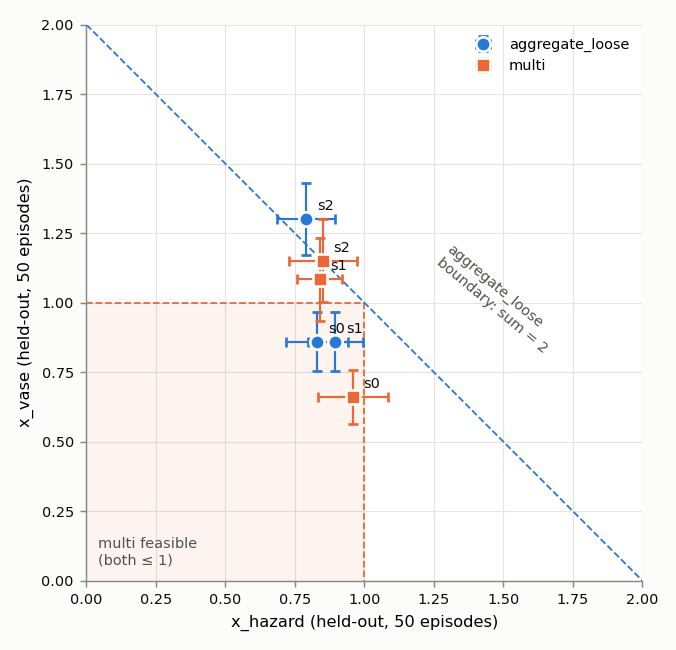
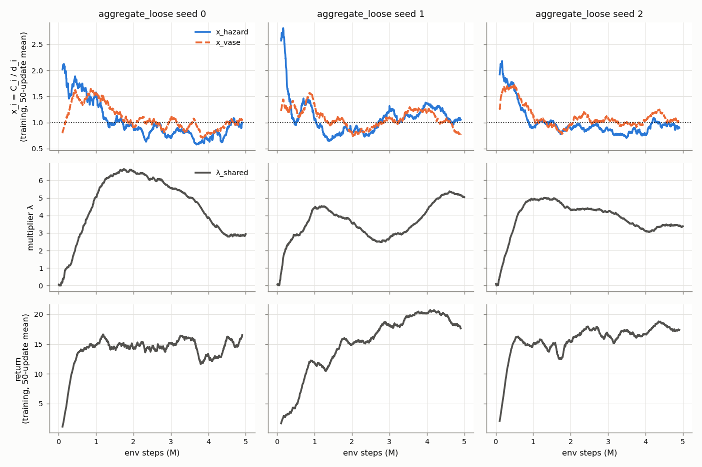
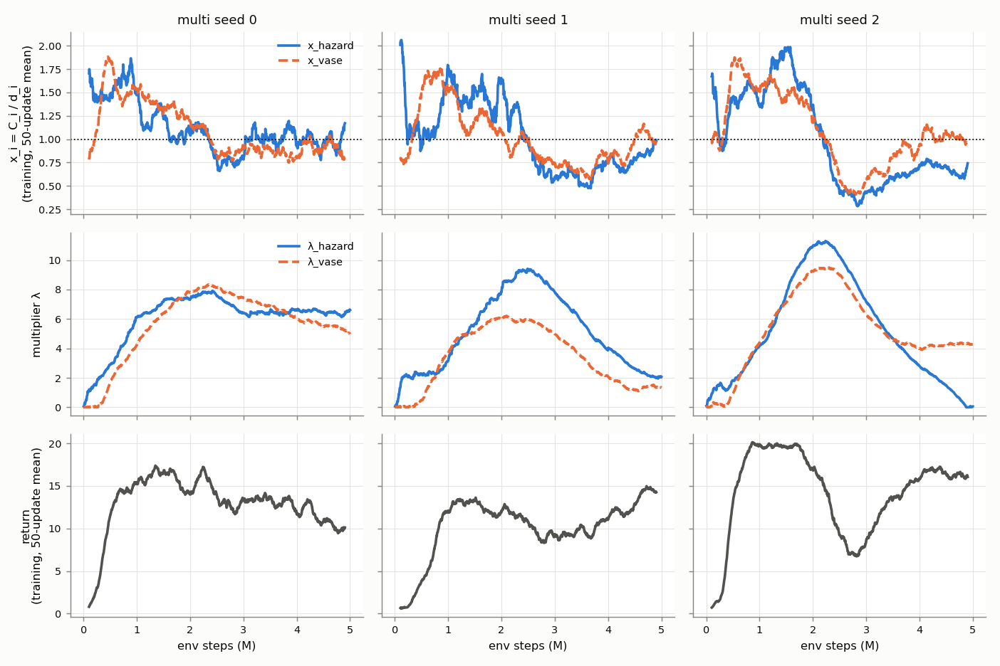

# E10 spg-v2: E4 at 5M steps with faster duals (SafetyPointGoal2)

Config: [`configs/safety/spg-v2.json`](../../configs/safety/spg-v2.json). Run on the lab machine
2026-10-23 → 2026-10-24. Raw outputs: `runs/spg-v2-aggregate-loose/`, `runs/spg-v2-multi/` (not
committed; renamed from `sg-pilot-v2-*` after training). W&B project `multi-cost-rl`, groups
`spg-v2-aggregate-loose` and `spg-v2-multi`.

Budgets d_hazard = 31.9, d_vase = 73.9 (E3); x_i = C_i / d_i. 5M steps per run (1250 updates),
seeds 0/1/2. Dual lr: aggregate_loose 0.02, multi 0.04. Figures: `python scripts/plot_runs.py
runs/spg-v2-aggregate-loose runs/spg-v2-multi --output reports/spg-v2`.

## Held-out results

Final checkpoint, stochastic policy, the 50 E4 layouts (environment seed 900000, action seed
900001, `--eval-num-envs 10`). ± is the standard error over the 50 episodes.

| Run | Return | Goals/ep | x_hazard | x_vase | x_h + x_v | Native met | Both ≤ 1 | Episode pass rate |
|---|---:|---:|---:|---:|---:|---|---|---:|
| aggregate_loose s0 | 16.3 ± 0.8 | 6.4 | 0.83 ± 0.11 | 0.86 ± 0.11 | 1.69 | yes | yes | 0.42 |
| aggregate_loose s1 | 18.1 ± 0.6 | 7.0 | 0.90 ± 0.10 | 0.86 ± 0.11 | 1.76 | yes | yes | 0.38 |
| aggregate_loose s2 | 16.2 ± 0.7 | 6.5 | 0.79 ± 0.11 | 1.30 ± 0.13 | 2.09 | no | no | 0.36 |
| multi s0 | 10.4 ± 0.9 | 4.5 | 0.96 ± 0.13 | 0.66 ± 0.10 | 1.62 | yes | yes | 0.42 |
| multi s1 | 15.6 ± 0.5 | 6.0 | 0.84 ± 0.08 | 1.08 ± 0.15 | 1.92 | no | no | 0.40 |
| multi s2 | 17.7 ± 0.9 | 7.1 | 0.85 ± 0.12 | 1.15 ± 0.15 | 2.00 | no | no | 0.40 |
| **aggregate_loose mean** | **16.9** | 6.6 | 0.84 | 1.01 | 1.85 | 2/3 | 2/3 | 0.39 |
| **multi mean** | **14.6** | 5.9 | 0.88 | 0.97 | 1.85 | 1/3 | 1/3 | 0.41 |
| E4 aggregate_loose (2M) | 12.2 | 5.0 | 0.59 | 0.81 | 1.41 | 3/3 | 2/3 | — |
| E4 multi (2M) | 19.3 | 7.6 | 1.59 | 1.37 | 2.96 | 0/3 | 0/3 | — |
| E4 unconstrained (2M) | 22.4 | 8.6 | 1.76 | 1.84 | 3.60 | — | 0/3 | — |

Episode pass rate = fraction of episodes with both C_i ≤ d_i. E4 rows are from the lab-meeting
notes (branch1 code, chunk 10, same layouts).

## Training curves

Training-batch costs and returns (4 episodes per update, 50-update moving average) and the multipliers.

Mean of the last 250 updates (1000 training episodes, 4M–5M steps):

| Run | Return | x_hazard | x_vase | λ at end | λ change, last quarter |
|---|---:|---:|---:|---|---|
| aggregate_loose s0 | 14.5 | 0.87 | 0.94 | 2.94 | −1.66 |
| aggregate_loose s1 | 19.3 | 1.17 | 0.99 | 5.04 | +1.37 |
| aggregate_loose s2 | 17.8 | 0.95 | 1.11 | 3.38 | −0.07 |
| multi s0 | 11.0 | 1.00 | 0.89 | 6.62 / 4.98 | +0.22 / −1.59 |
| multi s1 | 13.1 | 0.80 | 0.92 | 2.07 / 1.34 | −2.51 / −1.11 |
| multi s2 | 16.5 | 0.71 | 1.03 | 0.06 / 4.28 | −3.61 / −0.08 |

## Findings

1. **Both methods now sit at the budget, which E4 did not reach.** Held-out sums are 1.85 for
   both; per-cost means are within one standard error of 1. aggregate_loose is no longer
   over-constrained (return 12.2 → 16.9). multi is no longer infeasible (x 1.59/1.37 → 0.88/0.97)
   and paid for it in return (19.3 → 14.6).
2. **Not converged.** The multipliers peaked at 2.1–2.5M steps for multi (λ 8–11) and at
   1.3–1.8M for aggregate_loose (λ 4.5–6.6; seed 1 rose again to 5.4 at the end). Costs then fell below budget (multi s2: sum 0.84 at about 3M steps, return 7.8), and
   the multipliers have been coming down since. multi s2's λ_hazard reached 0 at the end, so its
   hazard cost will rise again. This is the slow, damped oscillation of an integral-only
   controller (progress.md §2.6). The E4 runs stopped at 2M, before the peak.
3. **aggregate_loose trades one cost against the other.** In training (last 250 updates) seed 1
   has x_hazard 1.17 and seed 2 has x_vase 1.11, with sums close to 2. On held-out, seed 2 has
   x_vase 1.30 (2.3 standard errors above 1). This is the exploit the shared budget allows.
   multi's training means are at or below 1 for both costs in all seeds.
4. **No method difference is established.** aggregate_loose has higher mean return (16.9 vs
   14.6), but multi s0 (10.4, still λ ≈ 6.6 / 5.0) drives most of the gap, and 3 seeds with
   non-stationary multipliers cannot separate the two. The feasible sets also differ
   (triangle vs square), so return alone is not a fair comparison.
5. **Per-seed held-out pass/fail is noise.** With 50 episodes the standard error of x_i is about
   0.1–0.15, so 1.08 or 1.15 does not differ from 1 at that sample size. Use more held-out episodes,
   or average several late checkpoints, before counting seeds.

## Next

- Damp the oscillation instead of only adding steps: PID Lagrangian (Stooke et al., 2020), or
  a smaller dual lr after the first peak. Report the average of the last N checkpoints too.
- 5+ seeds and 200+ held-out episodes before claiming a method difference.
- Matched feasible sets (aggregate_conservative, or a budget sweep: return vs joint pass rate).
- Interpretation B (violation-adaptive weights) for the lab meeting: progress.md §6.
